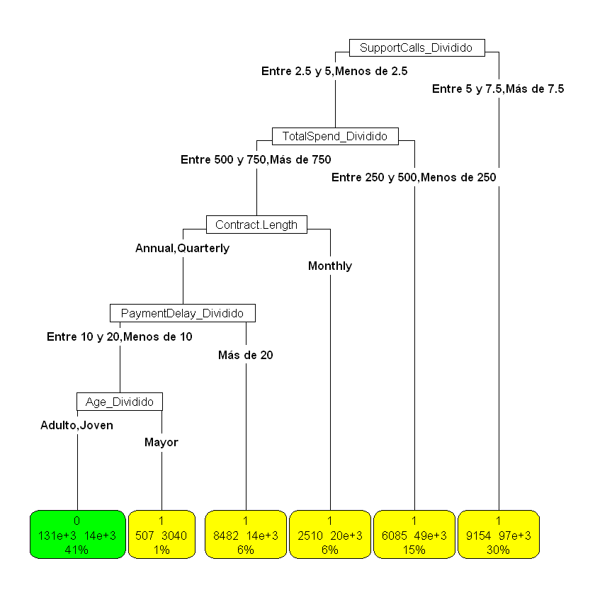

# Predicción de abandono de clientes (Customer Churn)

Clasificación binaria en **R** para predecir si un cliente abandonará un servicio por suscripción, comparando un árbol de decisión, Naive Bayes y regresión logística, y analizando qué variables pesan más en la decisión.

📓 **Notebook completo:** [`customer_churn_prediction.ipynb`](./customer_churn_prediction.ipynb) (con código, salidas, gráficos y análisis)

## Resultados

| Modelo | Accuracy | Detección de abandonos (*Specificity*) | F1-Score clase 0 |
|---|---|---|---|
| Árbol de decisión base | 88,6 % | 92,9 % | 0,865 |
| Árbol + PCA | 82,9 % | 86,6 % | 0,801 |
| Naive Bayes | 85,7 % | 83,5 % | 0,846 |
| Regresión logística | 84,7 % | 84,7 % | 0,831 |
| **Árbol tras estudio de ablación** | **92,0 %** | **96,6 %** | **0,905** |
| Árbol sensible al coste (pérdida 4:1) | 89,6 % | **98,2 %** | — |

*Todas las métricas se calculan sobre un conjunto de prueba que el modelo no ha visto (más de 100.000 clientes). Por defecto `caret` toma la clase `0` (no abandona) como positiva; por eso el F1 y el recall de la tabla se refieren a esa clase y la capacidad de detectar abandonos se reporta como *Specificity*.*

## Hallazgos principales

- **Un árbol sencillo gana.** Tras eliminar variables una a una (estudio de ablación), solo 5 variables (`Age`, `Support.Calls`, `Payment.Delay`, `Contract.Length`, `Total.Spend`) bastan para un 92,0 % de accuracy, superando a Naive Bayes y a la regresión logística.
- **Qué empuja a un cliente a irse:** contrato mensual (90 % de abandono), más de 5 llamadas a soporte (91 %), retrasos de pago superiores a 20 días (87 %), gasto total bajo (menos de 500, ≈ 90 %) y edad de 60 años o más (90 %).
- **El PCA no ayuda:** las variables numéricas apenas están correlacionadas, así que no hay dimensionalidad que reducir y el rendimiento empeora.
- **El umbral es una decisión de negocio.** Penalizando 4 veces más un abandono no detectado que una falsa alarma, el árbol detecta el 98,2 % de los abandonos (1.381 clientes en riesgo más) a costa de unas 3,7 falsas alarmas por cada abandono extra detectado.

## Datos

`Datos.csv`: 505.208 clientes (505.206 tras eliminar nulos), 10 variables predictoras y la variable objetivo `Churn` (≈ 55 % abandona).

**Fuente:** [Customer Churn Dataset](https://www.kaggle.com/datasets/muhammadshahidazeem/customer-churn-dataset) de Muhammad Shahid Azeem en Kaggle, publicado bajo licencia [GPL 2](http://www.gnu.org/licenses/old-licenses/gpl-2.0.en.html).

| Tipo | Variables |
|---|---|
| Numéricas | `Age`, `Tenure`, `Usage.Frequency`, `Support.Calls`, `Payment.Delay`, `Total.Spend`, `Last.Interaction` |
| Categóricas | `Gender`, `Subscription.Type`, `Contract.Length` |
| Objetivo | `Churn` (1 = abandona, 0 = permanece) |

## Metodología

1. **Exploración:** carga, conversión de tipos, limpieza de nulos, distribuciones y relación de cada variable con `Churn`.
2. **Preparación:** discretización de las variables numéricas en tramos con significado propio.
3. **Modelado y evaluación:** árbol de decisión (`rpart`, con y sin PCA), Naive Bayes (`naivebayes`/`e1071`, validación cruzada de 10 pliegues) y regresión logística (`glm`), cada uno con su estudio de ablación.
4. **Comparación y mejora de negocio:** elección del modelo final y árbol sensible al coste mediante una matriz de pérdidas.

## Cómo reproducirlo

Requisitos: R (el notebook se ejecutó con 4.5) y un entorno Jupyter con el kernel de R (`IRkernel`), por ejemplo en VS Code.

1. Clona el repositorio y abre `customer_churn_prediction.ipynb`.
2. Selecciona el kernel **R** y ejecuta las celdas en orden **desde la carpeta del repositorio** (el notebook lee `Datos.csv` con ruta relativa).

Los paquetes necesarios se instalan automáticamente si faltan: `tidyverse`, `patchwork`, `rpart`, `rpart.plot`, `caret`, `factoextra`, `FactoMineR`, `naivebayes`, `e1071` y `dplyr`.

> La primera partición entrenamiento/prueba del árbol base no fija semilla, por lo que sus cifras pueden variar ligeramente entre ejecuciones. El resto de modelos sí la fijan.

## Limitaciones

- Las variables del árbol final se seleccionaron con el mismo conjunto de prueba con el que se evalúa, por lo que su accuracy es algo optimista. Lo ideal sería un conjunto de validación o validación cruzada.
- Cada modelo usa su propia partición, así que las diferencias de unas décimas deben leerse con cautela; las diferencias grandes sí son robustas.
- Los saltos tan bruscos en las tasas de abandono y las distribuciones casi uniformes sugieren que los datos podrían ser sintéticos; conviene validar las conclusiones con datos reales.
- Siguientes pasos: modelos de conjunto (*random forest*, *gradient boosting*), curvas ROC/AUC y ajuste del umbral de probabilidad.

## Autor

Pablo Alonso Zapatero — Fundamentos de Ciencia de Datos, Universidad de Alcalá.
